# JavaScript Basics Introduction

**Student Details:** 
* **Name:** Leow Yi Xing 
* **Matric Number:** AI250240

## About This Repository
This repository is a simple introduction to JavaScript and its basic concepts. It covers topics such as variables, data types, functions, loops, and conditionals, and includes examples and exercises to help reinforce the concepts learned.

## Instructions to Run the Code
1. Make sure you have Node.js installed on your machine. You can download it from [nodejs.org](https://nodejs.org/).
2. Clone this repository to your local machine using the command: `git clone <repository_url>`
3. Navigate to the project directory in your terminal.
4. Run the code using the command: `node <filename>.js`

## Output

* **Question 1**

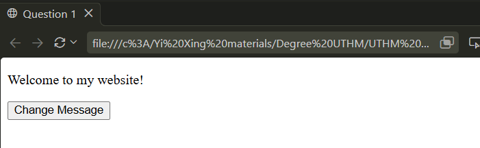

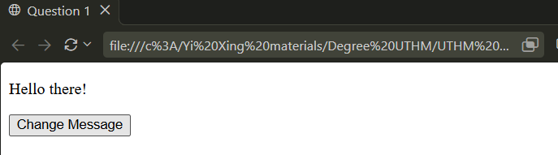

* **Question 2**

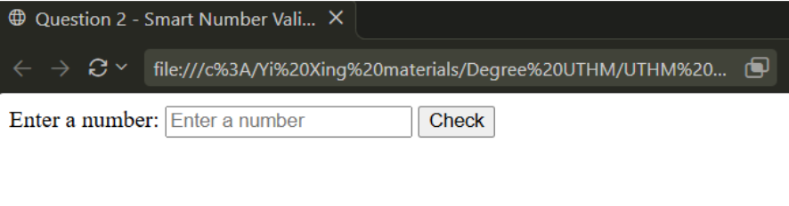
  
* **Case 1:** When number is less than 10

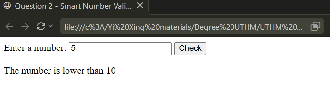

* **Case 2:** When number is equal to 10

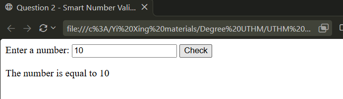

* **Case 3:** When number is greater than 10

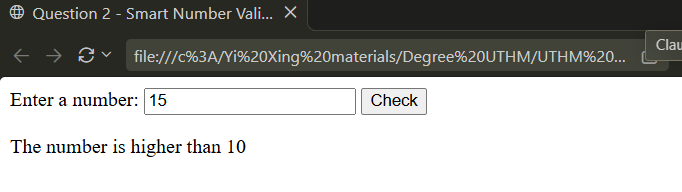

* **Case 4:** When number is not a number

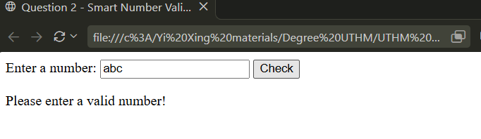

* **Case 5:** When number is empty

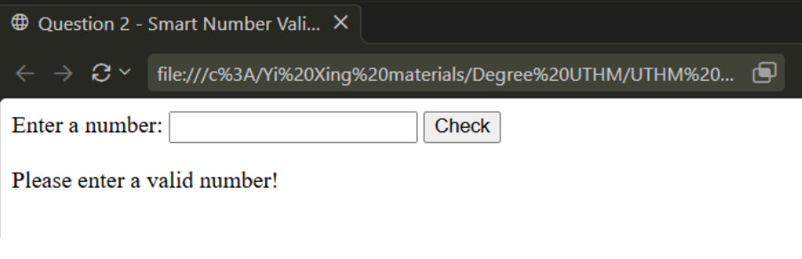

* **Case 6:** When number is a decimal

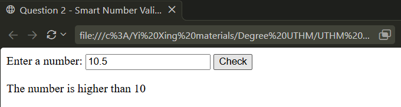

* **Question 3**

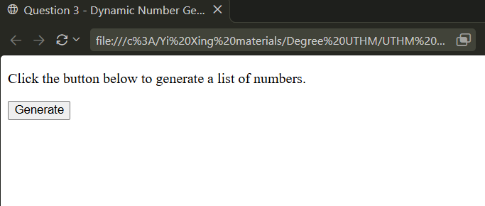

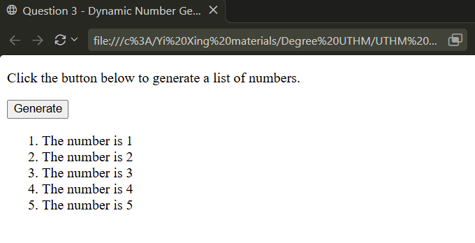